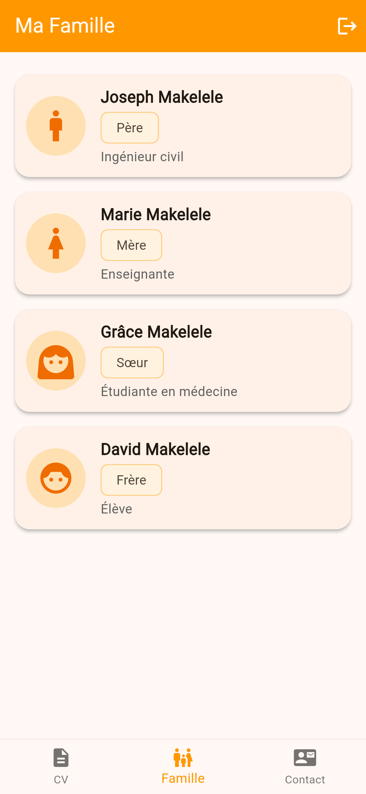
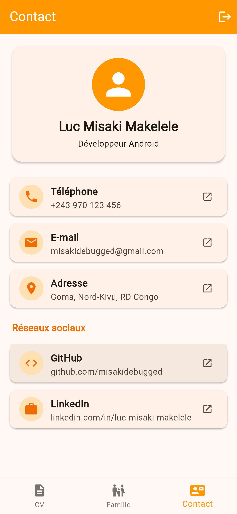

# Flutter CV Application

Application CV minimaliste développée avec Flutter comprend quatre pages : une page de connexion, une page d'accueil, un onglet « Famille » et un onglet « Contact ». (À l'exception de mon nom, toutes les autres informations sont fictives afin de préserver la confidentialité de mes données personnelles.)

## Identifiants de connexion generic

- **Identifiant** : `misaki`
- **Mot de passe** : `misaki123`

## Fonctionnalités

- Page de connexion avec champs identifiant / mot de passe
- Page d'accueil : CV complet (photo, formation, expériences, compétences, langues, centres d'intérêt)
- Page famille : liste des membres avec nom, photo et lien de parenté
- Page contact : coordonnées cliquables (appel, e-mail, carte, réseaux sociaux)
- Navigation via BottomNavigationBar

## Captures d'écran

<table>
  <tr>
    <td align="center"> Connexion</td>
    <td align="center"> CV</td>
    <td align="center"> Famille</td>
    <td align="center"> Contact</td>
  </tr>
</table>