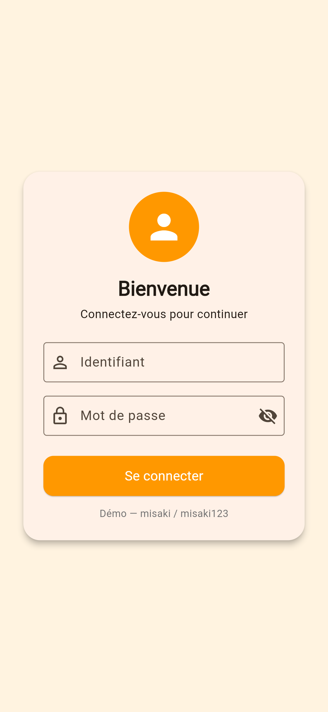

# Mini Projet Flutter

Application Flutter présentant un CV, page famille et pages coordonnées,
avec gestion dynamique des membres de la famille via une API REST.

## Démonstration REST avec API
Source API provenance de [`espoirbaraka/api-test`](https://github.com/espoirbaraka/api-test)

<!-- ═══════════════════════════════════════════════════════════════════
     👇 INSÉRER LA VIDÉO DE DÉMONSTRATION ICI 

    

<!-- VIDÉO DE DÉMONSTRATION — à remplacer -->

## Identifiants de connexion

L'authentification est gérée par l'API (`POST /accounts/login`).
Créer un compte au préalable via `POST /accounts/register`, puis se connecter
avec les mêmes identifiants dans l'application.

## Fonctionnalités

### Exercise 01 — Présentation statique
- Page de connexion
- Page d'accueil : CV complet (photo, formation, expériences, compétences, langues, centres d'intérêt)
- Page famille : liste des membres avec nom, photo et lien de parenté
- Page contact : coordonnées cliquables (appel, e-mail, carte, réseaux sociaux)
- Navigation via BottomNavigationBar

### Exercise 02 — Intégration d'une API REST
- **Authentification réelle** : la page de connexion appelle l'endpoint
  `POST /accounts/login` de l'API (plus aucune simulation locale).
- **Gestion des membres de la famille** : la page Famille est désormais
  alimentée par l'API et permet les opérations CRUD complètes :
  - **Consulter** — `GET /famille-membres`
  - **Ajouter** — `POST /famille-membres` (avec upload d'image facultatif)
  - **Modifier** — `PUT /famille-membres/{id}` (sans changer l'image)
    ou `POST /famille-membres/{id}` (avec nouvelle image)
  - **Supprimer** — `DELETE /famille-membres/{id}`
- Les données sont persistées dans la base MySQL (`api`) utilisée par l'API,
  et non stockées localement dans l'application.

## Captures d'écran

<table>
  <tr>
    <td align="center"><br/><sub>Connexion</sub></td>
    <td align="center"><br/><sub>CV</sub></td>
    <td align="center"><br/><sub>Famille</sub></td>
    <td align="center"><br/><sub>Contact</sub></td>
  </tr>
</table>

## Architecture

```
lib/
├── main.dart                    # Point d'entrée + thème orange
├── services/
│   └── api_service.dart         # Client HTTP pour l'API REST
└── pages/
    ├── login_page.dart          # Authentification via API
    ├── main_navigation.dart     # BottomNavigationBar (CV / Famille / Contact)
    ├── home_page.dart           # CV statique
    ├── family_page.dart         # Liste des membres (GET) + suppression (DELETE)
    ├── family_form_page.dart    # Formulaire d'ajout / modification
    └── contact_page.dart        # Coordonnées cliquables
```

## Configuration de l'API

L'application cible l'API par défaut à l'adresse :

```
http://localhost/api-test/public
```

Cette valeur est définie dans `lib/services/api_service.dart` (constante
`kApiBaseUrl`). Pour tester sur un autre environnement, la modifier :

| Cible | URL à utiliser |
|-------|----------------|
| Chrome (`flutter run -d chrome`) | `http://localhost/api-test/public` |
| Émulateur Android | `http://10.0.2.2/api-test/public` |
| Téléphone physique (même Wi-Fi) | `http://<IP-LAN-du-PC>/api-test/public` |

## Prérequis

- Flutter SDK
- XAMPP (Apache + MySQL) avec l'API [`espoirbaraka/api-test`](https://github.com/espoirbaraka/api-test)
  installée dans `C:\xampp\htdocs\api-test`
- Base de données `api` créée et `api.sql` importé
- `android:usesCleartextTraffic="true"` activé dans `AndroidManifest.xml`
  (nécessaire pour les appels HTTP en clair depuis Android)

## Lancer le projet

```bash
flutter pub get
flutter run -d chrome    # ou -d <device-id> pour un appareil Android
```